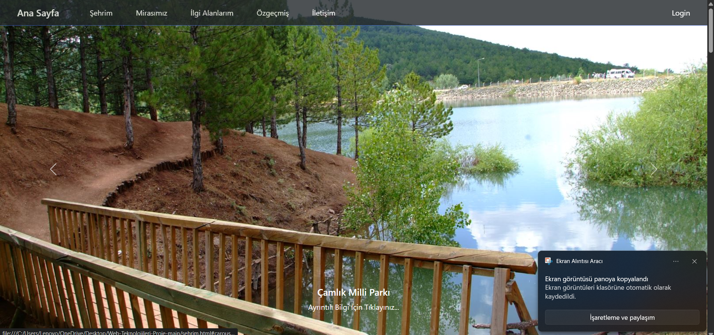
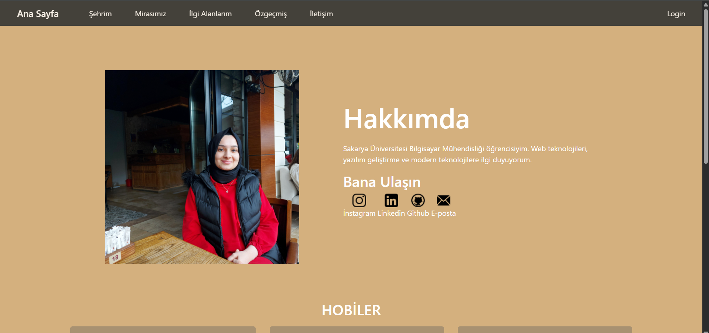
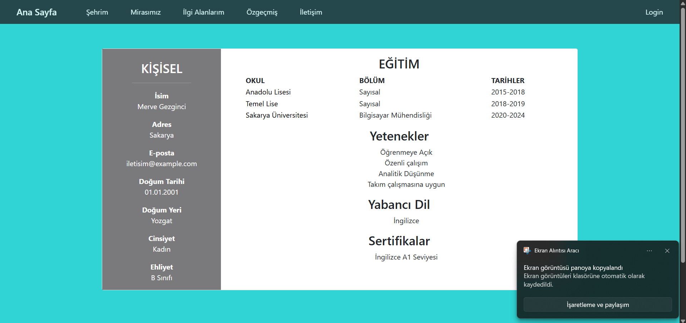
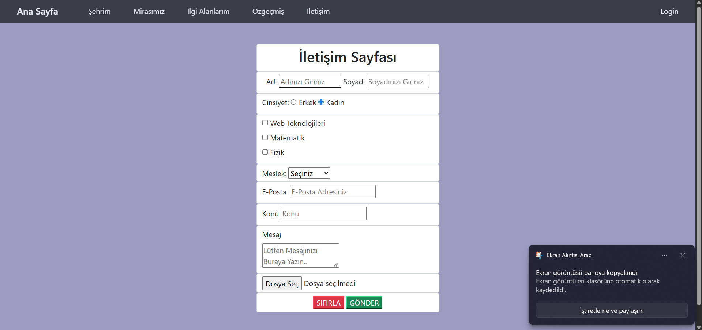
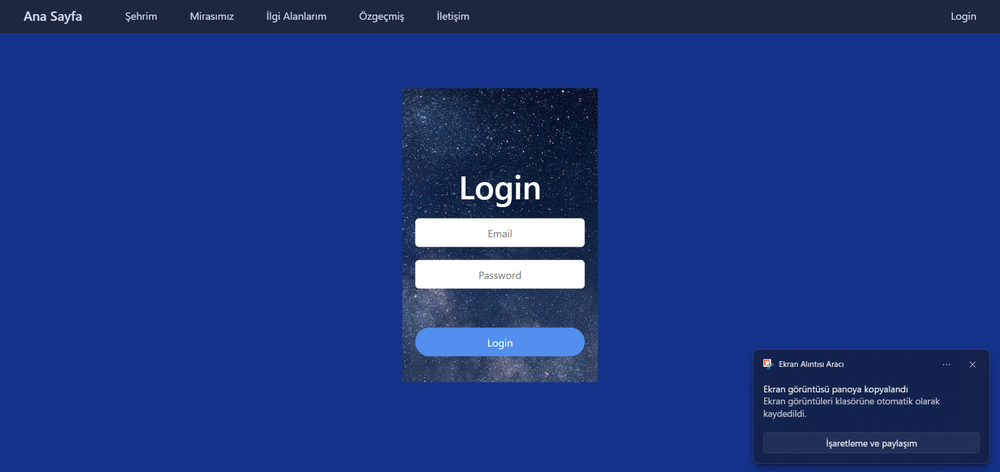

# 🌐 Web Teknolojileri - Kişisel & Şehir Rehberi Web Sitesi

Bu proje; HTML5, CSS3, JavaScript, Bootstrap ve PHP kullanılarak geliştirilmiş, duyarlı (responsive) tasarıma ve istemci/sunucu taraflı form doğrulamalarına sahip bir web sitesidir.

Sakarya Üniversitesi Bilgisayar Mühendisliği Bölümü **Web Teknolojileri** dersi (2022-2023) kapsamında geliştirilmiştir.

---

## 📸 Ekran Görüntüleri

### 🌆 Şehrim (Dinamik Resim Slider)

  

 

### 🏠 Hakkımda & Kişisel Sayfa

  

 

### 📄 Özgeçmiş (CV) & 📬 İletişim Formu

  
  &nbsp;&nbsp;&nbsp;&nbsp;
  

 

### 🔐 Giriş / Login (PHP Doğrulama)

  

---

## ✨ Proje Modülleri ve Özellikleri

- **🌆 Şehrim (Şehir Rehberi):**
  - Tarihi ve turistik mekanları tanıtan dinamik slider (atlıkarınca) yapısı.
  - İlgili mekanlara ve detaylı bilgilere yönlendiren interaktif bağlantılar.
- **🏠 Hakkımda & İlgi Alanlarım:** 
  - Kişisel tanıtım metni, hobiler ve sosyal medya bağlantıları.
- **📄 Özgeçmiş (CV):** 
  - Eğitim geçmişi, teknik yetenekler ve sertifikaların listelendiği responsive kart tasarımı.
- **📬 İletişim Formu (JavaScript Doğrulaması):**
  - İsim, e-posta, cinsiyet, ilgi alanları ve mesaj alanları.
  - İstemci tarafında (`iletisim.js`) çalışan regex ve boşluk kontrolleri ile form validasyonu.
  - Hatalı veya eksik girişlerde kullanıcıyı bilgilendiren dinamik bildirimler.
- **🔐 Giriş / Login (PHP Kimlik Doğrulama):**
  - Kullanıcı e-posta ve şifre kontrolü (`login.php`).
  - Başarılı girişte onay mesajı, hatalı girişte 2 saniye sonra otomatik geri yönlendirme.

---

## 🛠️ Kullanılan Teknolojiler

| Alan | Teknoloji | Açıklama |
|---|---|---|
| **İşaretleme & Yapı** | HTML5 | Semantik web elementleri |
| **Biçimlendirme** | CSS3 & Bootstrap | Responsive (mobil uyumlu) ızgara sistemi ve özel stiller |
| **İstemci Betikleri** | JavaScript (ES6) | DOM manipülasyonu ve form girdi doğrulamaları |
| **Sunucu Tarafı** | PHP | Form verisi işleme ve oturum kontrolü |

